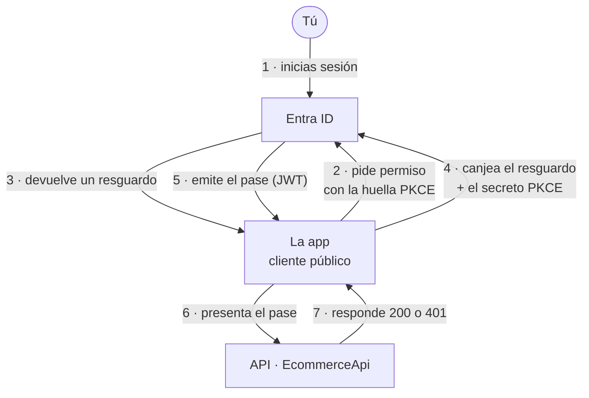

# 01 | OAuth 2.0, PKCE y validación de JWT

Cuando una aplicación quiere leer tus datos, lo habitual es que te pida la contraseña. Aquí se hace lo contrario: la aplicación te manda a hablar con Microsoft Entra ID, que le entrega un pase temporal y limitado a una API concreta. Nadie guarda tu contraseña y el pase caduca solo.

El módulo explica cómo se pide ese pase (PKCE) y cómo la API comprueba que es auténtico antes de dejar pasar la petición (JWT). Es la primera capa del modelo: si la puerta de entrada falla, las demás dan igual.

El paso 4 es el que hace PKCE. Si alguien intercepta el resguardo del paso 3, no puede canjearlo porque no tiene el secreto.

## Estado

El módulo cubre dos piezas con madurez distinta y conviene no leerlas como una sola.

| Pieza | Qué es | Estado |
|---|---|---|
| Validación JWT en la API .NET ([`lab-api-local-azure`](https://github.com/lanuzalorenzo/lab-api-local-azure)) | Comprueba firma y claims en cada petición | **Validado**, probado en CI |
| [Práctica manual PKCE](practicas/01-pkce-manual/README.md), API Node local | Pide el pase a mano, paso a paso | **Parcial**: runbook completo, evidencia pendiente |
| Reejecución con tenant de laboratorio | Cierra la evidencia con fecha y entorno | **Pendiente** |

El código está y el procedimiento es reproducible. Falta volver a ejecutarlo y guardar la prueba con el formato de evidencia del portfolio.

## Por dónde empezar

- [Conceptos](docs/01-conceptos.md): qué es un pase y por qué no se presta la contraseña.
- [Flujo OAuth 2.0 con PKCE](docs/02-flujo-oauth2-pkce.md): el paso a paso y los límites reales de PKCE.
- [Validación JWT y JWKS](docs/03-validacion-jwt-jwks.md): cómo comprueba la API el pase.
- [Práctica 01](practicas/01-pkce-manual/README.md): ejecución a mano, pruebas negativas y evidencia.

El código ejecutable está en [`lab/pkce`](lab/pkce/README.md) y las decisiones fechadas en la [bitácora](bitacora/). La [guía de lectura](../docs/guia-de-lectura.md) explica cómo se lee un módulo.

## Lo que no se ha podido probar

- La práctica de PKCE manual no se ha reejecutado: no hay tenant de laboratorio y la evidencia histórica no se guardó con el formato actual.
- El laboratorio Node.js es local y HTTP, sin TLS, tests ni CI. La pieza validada en CI es la API .NET del workload.

> Antes de migrar la API a `lab-api-local-azure`, este repositorio alojaba su documentación. Los ejemplos antiguos con `Authorization: Bearer $TOKEN` y JWT truncados con `...` son marcadores, no credenciales: se conservan por trazabilidad, están cubiertos por la allowlist de `.gitleaks.toml` y el historial no se reescribió. Si alguna vez se usó un token real, hay que rotarlo.
