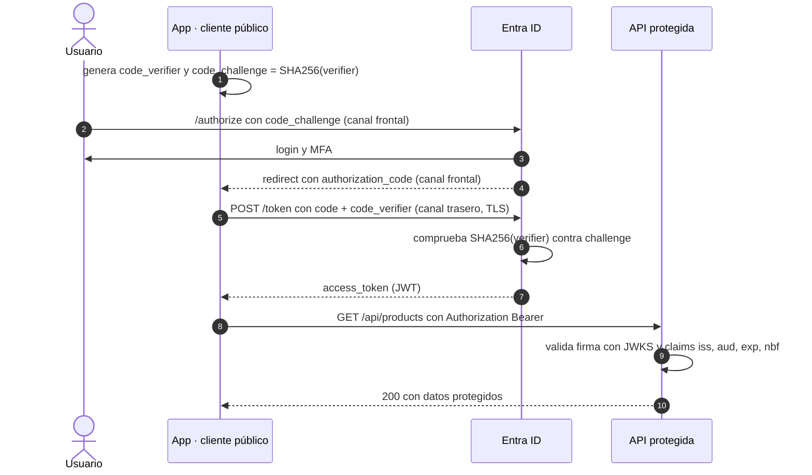

# Informe técnico — Flujo OAuth2 PKCE en Azure AD

**Proyecto:** Módulo 01 — OAuth 2.0, PKCE y validación de JWT.

## Objetivo
Documentar la implementación técnica del flujo OAuth2 Authorization Code con PKCE frente a Microsoft Entra ID (Azure AD), detallando las configuraciones necesarias en el portal, las particularidades del proveedor y la resolución de problemas frecuentes.

## Funcionamiento del flujo con PKCE

1. **Generación del reto criptográfico:** El cliente genera un `code_verifier` (cadena aleatoria) y un `code_challenge` (hash SHA256 del verifier).
2. **Authorization Request:** El cliente redirige al usuario a la URL de autorización de Azure AD (`https://login.microsoftonline.com/<tenant-id>/oauth2/v2.0/authorize`). La petición incluye `client_id`, `redirect_uri`, `scope`, `state`, `code_challenge` y `code_challenge_method=S256`.
3. **Autenticación y Consentimiento:** El usuario se autentica contra el tenant. Si la aplicación lo requiere, se le solicita consentimiento para los permisos solicitados.
4. **Emisión del Authorization Code:** Azure AD redirige al cliente entregando un `authorization_code` temporal.
5. **Intercambio por Tokens:** El cliente hace una petición POST al endpoint de token enviando el `authorization_code` y el `code_verifier` original.
6. **Validación y Entrega:** Azure AD aplica SHA256 al `code_verifier` y lo compara con el `code_challenge`. Si coinciden, emite el token de acceso (JWT).

## Canal frontal y canal trasero

PKCE separa dos momentos del flujo. Esa separación explica por qué el verifier no se filtra igual que el código.

- **Canal frontal** (pasos 2–4): viaja por la URL. El `code_challenge` es público porque es un hash; el `authorization_code` también, y por eso es la parte débil.
- **Canal trasero** (pasos 5–7): el `code_verifier` se envía una sola vez, en el cuerpo del POST y por TLS.

- El `code_challenge` es público: es un hash y no revela el verifier.
- El `authorization_code` viaja por la URL: queda en el historial, el referrer y los logs de redirección. Es la parte débil del flujo.
- El `code_verifier` viaja una sola vez, en el cuerpo del POST al endpoint de tokens, por TLS. No se envía a la API.

## Dónde se guarda el code_verifier

No existe un almacén invulnerable. El objetivo es reducir la exposición y la vida del secreto: se genera antes de redirigir, se recupera al volver y se borra tras el canje.

| Cliente | Almacenamiento habitual | Riesgo principal |
|---|---|---|
| SPA con redirect | `sessionStorage` de la pestaña | XSS; se borra al cerrar la pestaña |
| SPA con popup | Memoria | XSS; se pierde al recargar |
| App móvil | Keychain (iOS) / Keystore (Android) | Malware o dispositivo rooteado |
| App de escritorio | Almacén del sistema o memoria | Proceso comprometido |
| CLI | Memoria | Proceso comprometido |

Reglas:

- Nunca en `localStorage`, en la URL, en logs ni en cookies: persiste demasiado o queda expuesto.
- Borrar el verifier después del canje. Es de un solo uso y vive minutos, no días.
- Para SPAs de alto riesgo, usar el patrón **BFF** (*Backend for Frontend*): cliente confidencial en el backend y sesión por cookie, sin tokens ni verifier en el navegador.

## Límites de PKCE

PKCE protege el canje del código, no el token ya emitido ni un cliente comprometido.

| Amenaza | ¿La mitiga PKCE? | Control complementario |
|---|---|---|
| Interceptar el `code` en la redirección | Sí | TLS |
| Leer el `code` del historial o del referrer | Sí | `redirect_uri` exacta y registrada |
| XSS que lee el verifier | No | CSP; BFF reduce el robo de tokens |
| Malware o dispositivo comprometido | No | Almacén seguro y EDR |
| MITM sin TLS | No | TLS y HSTS |
| Robo del access token ya emitido | No | DPoP/mTLS |
| CSRF en la redirección | No | `state` |
| Replay del ID token | No | `nonce` |

Si un atacante puede leer el POST a Entra, también puede leer el token en el cliente. PKCE reduce la superficie de un ataque remoto de interceptación; no convierte un dispositivo comprometido en seguro.

## Sesiones y revocación

PKCE termina cuando se emiten los tokens. A partir de ahí, el ciclo de vida es otro.

| Elemento | Vida aproximada | Dónde se usa | Efecto de revocar sesiones |
|---|---|---|---|
| Access token | ~60–90 min (configurable) | Cabecera `Authorization` hacia la API | **No** se invalida; sigue válido hasta `exp` |
| Refresh token | Días (~90 por defecto) | Solo en el endpoint de tokens | **Sí** se invalida; no se emiten nuevos access tokens |
| Sesión de aplicación | Según la aplicación | Cookie o token propio | No cambia |
| Conexión de red | Según TCP | SSH o HTTP | No se cierra |

Conviene no confundir tres cosas que se llaman «sesión»:

1. **Sesión de autenticación:** refresh token y cookie de Entra.
2. **Sesión de aplicación:** cookie o token propio de la API.
3. **Conexión de red:** socket TCP abierto.

Revocar sesiones en Entra invalida el refresh token y la cookie de autenticación, pero **no** los access tokens ya emitidos ni las conexiones TCP. Deshabilitar la identidad o bloquear con Conditional Access impide nuevos inicios de sesión y nuevas emisiones, pero no revoca el access token actual: para eso hay que esperar a `exp` o usar Continuous Access Evaluation en servicios compatibles, que acorta la ventana pero no es universal ni instantáneo.

## Implementación en Azure AD (App Registration)

Para que el flujo funcione correctamente, la aplicación debe estar configurada de manera precisa en Entra ID:

- **Plataforma del cliente:** Debe registrarse como aplicación de tipo *Single-page application (SPA)* o *Mobile and desktop applications* (Public Client). Esto habilita implícitamente el soporte para PKCE sin requerir un Client Secret.
- **Exposición de la API:** En la sección *Expose an API*, se configura el Application ID URI (habitualmente `api://<client-id>`) y se define un scope personalizado, típicamente `access_as_user`, para permitir la delegación de identidad.
- **Configuración de Scopes en el cliente:** Durante el *Authorization Request*, el cliente debe solicitar explícitamente este scope configurado (ej. `api://<api-client-id>/access_as_user`).

## Lecciones de Troubleshooting

Durante la integración y pruebas de laboratorio se identificaron y resolvieron los siguientes escenarios de error comunes en Entra ID:

| Código de Error Azure | Causas Comunes identificadas | Solución Aplicada |
| :--- | :--- | :--- |
| **AADSTS501481** | El `redirect_uri` no coincide, el cliente no está marcado como público, o PKCE no está bien formado. | Verificar que la URI de redirección coincide exactamente y que la plataforma en el App Registration es compatible con flujos públicos (SPA/Mobile). |
| **AADSTS90013** | Solicitud de `scope` incorrecto, falta de consentimiento del administrador, o permisos no aceptados por el usuario. | Validar que el scope solicitado tiene el formato `api://...` y que la API ha sido autorizada para delegar acceso (Admin Consent). |

## Consideraciones de Seguridad

- PKCE protege el `authorization_code` frente a ataques de interceptación durante la redirección al navegador.
- Al actuar como *Public Client*, no se almacena un secreto estático (`client_secret`): el `code_verifier` es efímero, de un solo uso y vive minutos. Esto reduce el riesgo de fuga de credenciales estáticas, pero no elimina el riesgo de XSS ni de un dispositivo comprometido.
- PKCE no sustituye a `state`, `nonce`, TLS ni a la validación del token en la API.
- Aunque PKCE nació para clientes públicos, la práctica actual (RFC 9700) lo recomienda también en clientes confidenciales como defensa en profundidad.
- Revocar sesiones invalida refresh tokens y cookies de autenticación, no los access tokens ya emitidos.

### Reglas prácticas

- No enviar `client_secret` en clientes públicos: el `code_verifier` es efímero y de un solo uso.
- Usar siempre `S256` como método de challenge, nunca `plain`.
- Validar el JWT en la API, nunca en el front-end.
- Mantener el `redirect_uri` exacto y registrado; es la causa más común de `AADSTS501481`.
- Antes de depurar un fallo de permisos, comprobar scope, consentimiento y que el identificador de la API tiene el formato `api://...`.
- Borrar el `code_verifier` después del canje.

## Recursos de referencia

- [RFC 7636 - Proof Key for Code Exchange](https://datatracker.ietf.org/doc/html/rfc7636)
- [RFC 9700 - OAuth 2.0 Security Best Current Practice](https://datatracker.ietf.org/doc/rfc9700/)
- [Microsoft Entra ID - Flujo de código de autorización OAuth 2.0](https://learn.microsoft.com/azure/active-directory/develop/v2-oauth2-auth-code-flow)
- [Microsoft Entra ID - Refresh tokens](https://learn.microsoft.com/entra/identity-platform/refresh-tokens)
- [Microsoft Entra ID - Revocar el acceso de un usuario en una emergencia](https://learn.microsoft.com/entra/identity/users/users-revoke-access)
