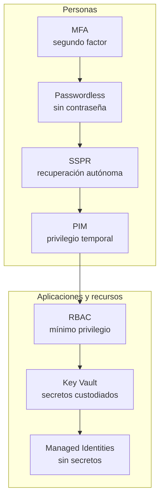

# 02 | Seguridad de identidades en Microsoft Entra ID

Una contraseña filtrada basta para entrar en una cuenta. Los siete controles de este módulo existen para que esa contraseña, sola, no sirva: un segundo factor, la supresión de la contraseña, la recuperación sin soporte, el privilegio temporal, el mínimo privilegio, la custodia de secretos y, al final, la desaparición de los secretos.

Los cuatro primeros protegen a las personas. Los tres últimos protegen a las aplicaciones y a los recursos donde trabajan.

## Los siete controles

| # | Control | Qué evita | Estado |
|---|---|---|---|
| 01 | [MFA](practicas/01-mfa/README.md) | Entrar con una contraseña robada | **Validado** |
| 02 | [Passwordless](practicas/02-passwordless/README.md) | Que la contraseña exista | **Validado** |
| 03 | [SSPR](practicas/03-sspr/README.md) | Recuperar la cuenta por teléfono con soporte | **Validado** |
| 04 | [PIM](practicas/04-pim/README.md) | Privilegio permanente y sin justificar | **Parcial** |
| 05 | [RBAC](practicas/05-rbac/README.md) | Permisos de más sobre los recursos | **Validado** |
| 06 | [Key Vault](practicas/06-key-vault/README.md) | Secretos en código o en variables de entorno | **Validado** |
| 07 | [Managed Identities](practicas/07-managed-identities/README.md) | Que la aplicación tenga secretos que robar | **Validado** |

## Qué prueba esta evidencia

Las siete prácticas se ejecutaron en un tenant de laboratorio y quedaron registradas con informe técnico, bitácora fechada y tabla de resultados. Seis están validadas; la de PIM se quedó en parcial, porque la elevación efectiva exige licencia Entra ID P2 y el laboratorio no la tenía. Son evidencias documentales: no se conservaron capturas originales. No hay recursos de producción en ningún caso.

El detalle de configuración y las decisiones están en el informe técnico de cada práctica; el historial fechado, en la [bitácora](bitacora/).
