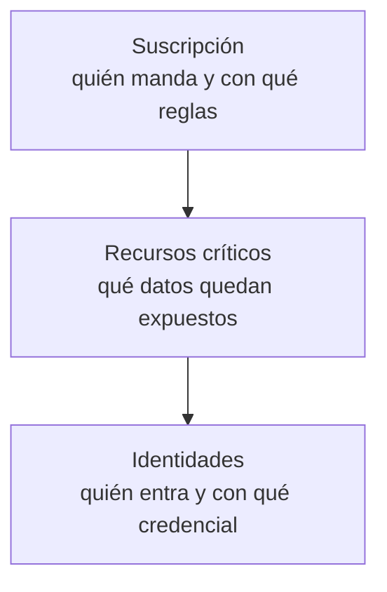

# 03 | Auditoría de entornos cloud

Una auditoría no arregla nada: mira lo que hay y lo pone por escrito. Este módulo revisa un entorno Azure de laboratorio desde fuera hacia dentro —la suscripción, los recursos que guardan los datos y las identidades que pueden entrar— y encuentra roles *Owner* repartidos entre personas, una cuenta de almacenamiento que aceptaba blobs anónimos, un servidor de SQL abierto a «todos los servicios de Azure» y un secreto de aplicación que no caducaba nunca. Cada hallazgo queda con su gravedad y su remediación.

La revisión va de la capa más ancha a la más sensible: primero qué reglas y permisos gobiernan el conjunto, después qué recursos guardan los datos y cómo están expuestos, y por último quién puede entrar y con qué credencial.

## Las tres revisiones

| # | Revisión | Pregunta | Hallazgos | Estado |
|---|---|---|---|---|
| 01 | [Suscripción](practicas/01-auditoria-suscripciones/README.md) | ¿La gobernanza y los permisos están bajo control? | 3 | **Validado** |
| 02 | [Recursos críticos](practicas/02-auditoria-recursos-criticos/README.md) | ¿Algún dato o servicio queda expuesto? | 4 | **Validado** |
| 03 | [Identidades y accesos](practicas/03-auditoria-identidades-y-accesos/README.md) | ¿Quién conserva privilegios o credenciales que ya no necesita? | 4 | **Validado** |

## Qué se ejecutó y qué solo se recomendó

Dos hallazgos se corrigieron en el laboratorio y se verificaron: el acceso anónimo a blobs, que ahora responde `409`, y la versión mínima de TLS, que quedó en 1.2 y rechaza los clientes antiguos. El resto son recomendaciones argumentadas, no cambios aplicados: migrar los roles a PIM, cerrar la regla de firewall de Azure SQL, activar *Purge Protection*, rotar el secreto permanente y reducir los administradores globales.

La evidencia es documental: informe técnico con matriz de hallazgos y bitácora fechada. No se conservaron capturas originales.
