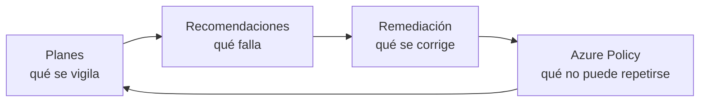

# 04 | Postura de seguridad con Defender for Cloud

Defender for Cloud hace dos cosas distintas que conviene no confundir: mide cómo de bien está configurado el entorno —la postura— y vigila lo que ocurre dentro de las máquinas y los servicios —la protección de cargas de trabajo—. La primera es gratuita y viene activada; la segunda se paga por recurso.

El módulo recorre las cuatro piezas de ese ciclo: qué planes se encienden, qué recomendaciones salen, qué se protege y cómo se impide que el fallo vuelva.

## Las cuatro prácticas

| # | Práctica | Qué añade | Estado |
|---|---|---|---|
| 01 | [Activación de planes](practicas/01-activacion-planes/README.md) | Elige qué se protege y a qué coste | **Validado** |
| 02 | [Recomendaciones](practicas/02-recomendaciones/README.md) | Convierte el panel en trabajo priorizado | **Validado** |
| 03 | [Workloads](practicas/03-workloads/README.md) | Lleva la detección dentro de las máquinas | **Validado** |
| 04 | [Policies y hardening](practicas/04-policies-hardening/README.md) | Impide que la mala configuración vuelva | **Validado** |

## Lo que se activó y lo que solo se evaluó

Del catálogo de planes se activaron el CSPM gratuito y Defender for Servers Plan 1. Defender CSPM, Defender for Storage y el Plan 2 se evaluaron y quedaron documentados, pero no se activaron por coste: sus capacidades se describen como lo que son, no como algo en marcha.

Tampoco se hicieron todas las pruebas. No se generaron alertas reales de malware ni se simularon ataques, porque eso exige un entorno aislado que este laboratorio no tiene. Esas pruebas aparecen como no ejecutadas, no como aprobadas.

La evidencia es documental: informe técnico y tabla de resultados en cada práctica. No hay capturas originales.

Este módulo no tiene bitácora. Las sesiones quedaron documentadas en las propias prácticas y en sus informes, y las entradas que había eran una plantilla rellenada sin ningún dato del entorno, así que se retiraron en octubre de 2026.
