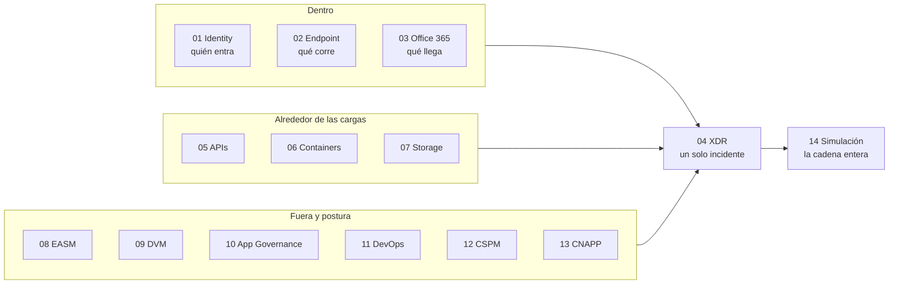

# 05 | Microsoft Defender Suite

Catorce productos con el mismo apellido. Se solapan lo suficiente como para contratar dos que vigilan lo mismo y dejar a oscuras la capa por la que entra el ataque. Casi nunca se compra de más por gusto: se compra mal por no tener el mapa.

Este módulo es el mapa. Ninguna de sus catorce prácticas conserva evidencia de ejecución, así que no demuestra la suite: ordena las piezas por la señal que producen y dice qué haría falta para probarlas. Lo que sí muestra es que catorce productos no son catorce compras: XDR no añade detección, junta la que ya existe; CNAPP no se activa, resulta de encender CSPM y las protecciones de carga.

> **Estado: Diseño.** La [matriz de requisitos](docs/requisitos.md) dice qué licencia, qué recurso y qué prueba cerrarían cada una.

## Las catorce piezas

| # | Pieza | La pregunta que responde |
|---|---|---|
| 01 | [Defender for Identity](practicas/01-defender-identity/README.md) | ¿Alguien usa credenciales que no le tocan? |
| 02 | [Defender for Endpoint](practicas/02-defender-endpoint/README.md) | ¿Qué se ejecuta en el equipo y desde cuándo? |
| 03 | [Defender for Office 365](practicas/03-defender-office365/README.md) | ¿Este enlace o adjunto es lo que dice ser? |
| 04 | [Defender XDR](practicas/04-defender-xdr/README.md) | ¿Estas cuatro alertas son un solo ataque? |
| 05 | [Defender for APIs](practicas/05-defender-apis/README.md) | ¿Alguien pide datos que no le corresponden? |
| 06 | [Defender for Containers](practicas/06-defender-containers/README.md) | ¿La imagen desplegada es la que se revisó? |
| 07 | [Defender for Storage](practicas/07-defender-storage/README.md) | ¿Lo que se sube es lo que debería? |
| 08 | [Defender EASM](practicas/08-defender-easm/README.md) | ¿Qué ve de mí quien me busca desde fuera? |
| 09 | [Defender Vulnerability Management](practicas/09-defender-vulnerability-management/README.md) | ¿Qué está desactualizado y por dónde se entra? |
| 10 | [Defender App Governance](practicas/10-defender-app-governance/README.md) | ¿Qué puede leer una app en nombre de todos? |
| 11 | [Defender for DevOps](practicas/11-defender-for-devops/README.md) | ¿El fallo entra en el commit o en el portal? |
| 12 | [Defender CSPM](practicas/12-defender-cspm/README.md) | ¿Qué configuración me expone y en qué orden? |
| 13 | [Defender CNAPP](practicas/13-defender-cnapp/README.md) | ¿Puedo seguir un fallo de la plantilla al runtime? |
| 14 | [Simulación y XDR](practicas/14-ataque-simulado-xdr/README.md) | ¿La suite detecta un ataque que yo mismo lanzo? |

## Lo que una simulación demuestra

La prueba final no valida una herramienta: valida la organización. Si cada producto abre su propio caso, no hay correlación por muchos paneles que se enciendan. El orden para llegar hasta ahí está en la [matriz](docs/requisitos.md), de lo barato a lo caro.
