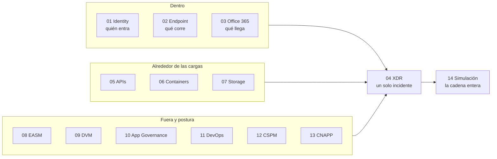

# 05 | Microsoft Defender Suite

Catorce productos con el mismo apellido. Se solapan lo suficiente como para contratar dos que vigilan lo mismo y dejar a oscuras la capa por la que entra el ataque. Casi nunca se compra de más por gusto: se compra mal por no tener el mapa.

Este módulo es el mapa. Ninguna de las catorce piezas tiene evidencia de ejecución en este portfolio, así que no demuestra la suite: la ordena por la señal que produce y deja escrito, en una sola matriz, qué licencia, qué recurso y qué prueba cerrarían cada una. Lo que sí muestra es que catorce productos no son catorce compras: XDR (detección y respuesta extendida) no añade detección, junta la que ya existe; CNAPP (postura y protección de cargas en una sola vista) no se activa, resulta de encender CSPM (gestión de la postura en la nube) y las protecciones de carga.

> **Estado: Diseño.** Ninguna de las catorce piezas conserva evidencia de ejecución. La [matriz de requisitos](docs/requisitos.md) dice qué licencia, qué recurso y qué prueba cerraría cada una. El módulo no tiene prácticas, runbook ni bitácora.

## Las catorce piezas, por la señal que producen

| Dónde mira | Piezas | La pregunta que responde |
|---|---|---|
| Dentro del tenant | Defender for Identity, for Endpoint, for Office 365 | ¿Quién entra, qué corre y qué llega? |
| Alrededor de las cargas | Defender for APIs, for Containers, for Storage | ¿Quién pide datos ajenos, qué imagen se desplegó y qué se subió? |
| Fuera y postura | EASM (lo que ya se ve de mí en Internet), Vulnerability Management, App Governance, DevOps, CSPM, CNAPP | ¿Qué ve de mí quien me busca, qué está desactualizado, qué puede leer una app y qué configuración me expone? |
| Correlación | XDR | ¿Estas cuatro alertas son un solo ataque? |
| La cadena entera | Simulación | ¿La suite detecta un ataque que yo mismo lanzo? |

La numeración 01–14 de la [matriz](docs/requisitos.md) identifica piezas de este módulo, no módulos del portfolio.

## Lo que una simulación demuestra

La prueba final no valida una herramienta: valida la organización. Si cada producto abre su propio caso, no hay correlación por muchos paneles que se enciendan. El orden para llegar hasta ahí está en la [matriz](docs/requisitos.md), de lo barato a lo caro.
