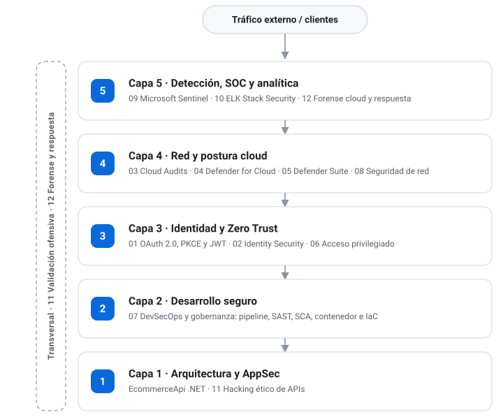

# Lorenzo Lanuza | Portfolio de Ciberseguridad, DevSecOps y Arquitectura

Proteger un sistema es como asegurar una casa: no basta una cerradura, hacen falta puertas, rejas, alarma y alguien que sepa qué hacer si suena. Este portfolio aplica Security by Design, DevSecOps, Cloud Security y respuesta a incidentes sobre una misma carga de trabajo, una API .NET protegida con Microsoft Entra ID, y recorre la **Defensa en Profundidad** capa a capa, separando lo probado de lo solo diseñado. Cada módulo responde a la misma pregunta: *¿qué control protege qué y cómo se demuestra?*

**In English.** Protecting a system is like securing a house: a lock is not enough —you need doors, bars, an alarm and someone who knows what to do when it goes off. This portfolio applies Security by Design, DevSecOps, Cloud Security and incident response to a single workload, a .NET API protected with Microsoft Entra ID, and walks through Defense-in-Depth layer by layer, separating what has been proven from what is only designed. Every module answers the same question: what does this control protect, and how is it demonstrated?

> Este repositorio describe laboratorios, código y documentación técnica. No representa despliegues de producción ni certificaciones. Cada práctica indica su estado: **Validado**, **Parcial**, **Runbook preparado**, **Diseño** o **Pendiente**. No se incluyen secretos, identificadores reales ni datos personales.

---

## Arquitectura de referencia

La carga de trabajo es **EcommerceApi** (Web API .NET 10 con validación de tokens OAuth 2.0, DTOs, tests y pipeline DevSecOps), versionada en [`lab-api-local-azure`](https://github.com/lanuzalorenzo/lab-api-local-azure).

La misma línea base se aplica a una segunda carga, **Comicteca** (Blazor WebAssembly y API .NET 10 sobre SQLite en local), versionada en [`comicteca`](https://github.com/lanuzalorenzo/comicteca). Comprueba que los controles compartidos se replican fuera del laboratorio —CORS cerrado por defecto, cabeceras y CSP, límite por IP, ProblemDetails, endpoint de salud, Docker sin root, CodeQL y Trivy sobre las imágenes—, salvo la validación de tokens, que allí sigue **Parcial**. Está en **Parcial**, no se presenta como producto ni como caso de estudio, y su despliegue sigue pendiente.

Los controles transversales —CORS cerrado por defecto, validación JWT, cabeceras de seguridad, límite por IP, formato de error, HTTPS con HSTS y endpoint de salud— se extraen a paquetes NuGet en [`shared-dotnet`](https://github.com/lanuzalorenzo/shared-dotnet): los paquetes `0.1.0` están publicados en GitHub Packages y `EcommerceApi` y `Comicteca` los consumen desde el feed con permiso de solo lectura de paquetes.

---

## Módulos y estado

| # | Módulo | Estado |
|---|---|---|
| 01 | [OAuth 2.0, PKCE y JWT](01-seguridad-azure/README.md) | Parcial |
| 02 | [Identity Security](02-identity-security/README.md) | Validado (documental) |
| 03 | [Cloud Audits](03-cloud-audits/README.md) | Validado (documental) |
| 04 | [Defender for Cloud](04-defender-for-cloud/README.md) | Validado (documental) |
| 05 | [Microsoft Defender Suite](05-defender-suite/README.md) | Diseño |
| 06 | [Acceso privilegiado](06-identity-protection/README.md) | Diseño |
| 07 | [DevSecOps y gobernanza](07-devsecops/README.md) | Validado en CI |
| 08 | [Seguridad de red en Azure](08-seguridad-red-azure/README.md) | Diseño + IaC estática |
| 09 | [Microsoft Sentinel](09-microsoft-sentinel/README.md) | Diseño |
| 10 | [ELK Stack Security](10-elk-stack-security/README.md) | Validado en local |
| 11 | [Hacking ético de APIs](11-hacking-etico-api/README.md) | Validado en local |
| 12 | [Forense cloud y respuesta](12-forense-cloud-respuesta/README.md) | Parcial |

**Criterio:** [Estados de validación](#estado-de-validación) — no se presenta un diseño como una validación.

---

## Qué leer primero

- **15 min:** [Guía de lectura](docs/guia-de-lectura.md) → [Índice de evidencias](laboratorio-final/evidencias/README.md) → tabla de estados arriba.
- **60–90 min (hilo identidad + API):** [Arquitectura](laboratorio-final/arquitectura.md) → [Módulo 01](01-seguridad-azure/README.md) → [Módulo 11](11-hacking-etico-api/README.md) + [evidencia BOLA](laboratorio-final/evidencias/2026-10-21-11-api-bola/README.md) → [Módulo 12](12-forense-cloud-respuesta/README.md) + [acta tabletop](laboratorio-final/evidencias/2026-10-22-12-tabletop/README.md).
- **Revisión técnica:** README → índice de evidencias → [módulo 11](11-hacking-etico-api/README.md) → [módulo 07](07-devsecops/README.md) → [API reference](https://github.com/lanuzalorenzo/lab-api-local-azure).

---

## Laboratorio final

[Arquitectura](laboratorio-final/arquitectura.md) · [Plan de ejecución](laboratorio-final/plan-ejecucion.md) · [Herramientas](laboratorio-final/herramientas.md) · [Índice de evidencias](laboratorio-final/evidencias/README.md).

> Evidencias de ejecución y documentales, con fecha y resultado, en el [índice](laboratorio-final/evidencias/README.md). Fases Azure pendientes de autorización, presupuesto y resource group temporal; **no hay recursos Azure desplegados**.

---

## Estado de validación

| Estado | Significado |
|---|---|
| **Validado** | Ejecutado y con evidencia enlazada (de ejecución, documental o verificable). |
| **Parcial** | Implementado en código o configuración, pero sin ejecución completa o con brechas. |
| **Runbook preparado** | Pasos y comandos escritos, sin ejecutar. Se muestra como «Diseño · runbook listo». |
| **Diseño** | Arquitectura, procedimiento o IaC documentados; no desplegados. |
| **Pendiente** | Identificado y no iniciado. |

---

## Ecosistema

| Repositorio | Rol |
|---|---|
| **Portfolio** | Documentación, prácticas y narrativa (este repo) |
| **API de referencia** | Código .NET, tests, CI y Bicep → [`lab-api-local-azure`](https://github.com/lanuzalorenzo/lab-api-local-azure) |
| **Segunda carga** | Los mismos controles en una aplicación propia —CORS, cabeceras y CSP, límite por IP, ProblemDetails, salud, Docker sin root, CodeQL y Trivy—, salvo la validación de tokens, todavía Parcial → [`comicteca`](https://github.com/lanuzalorenzo/comicteca) |
| **Aprendizaje en IA** | Guías de herramientas y agentes, experimentos medidos y criterios sobre qué datos salen de la red → [`lab-ia-aprendizaje`](https://github.com/lanuzalorenzo/lab-ia-aprendizaje) |
| **Automatización de CI** | Acciones y workflows compartidos: enlaces, anclas y compilación .NET → [`core`](https://github.com/lanuzalorenzo/core) |
| **Controles compartidos** | Paquetes NuGet con CORS, cabeceras, límite por IP, ProblemDetails y salud → [`shared-dotnet`](https://github.com/lanuzalorenzo/shared-dotnet) |
| **Plantillas de repositorio** | Esqueletos `dotnet new` con la línea base, CI y los controles compartidos → [`plantillas-dotnet`](https://github.com/lanuzalorenzo/plantillas-dotnet) |
| **Perfil** | Trayectoria y stack → [`lanuzalorenzo`](https://github.com/lanuzalorenzo) |
| **Web** | Portfolio visual y contacto → [`lanuzalorenzo.github.io`](https://lanuzalorenzo.github.io) |

---

## Contacto y licencia

**Autor:** Lorenzo Lanuza Arellano — *Software Engineer & Architect \| .NET, DevSecOps & Cloud Security*  
**LinkedIn:** [linkedin.com/in/lanuzalorenzo](https://www.linkedin.com/in/lanuzalorenzo) · **GitHub:** [github.com/lanuzalorenzo](https://github.com/lanuzalorenzo) · **Email:** [lanuzalorenzo@gmail.com](mailto:lanuzalorenzo@gmail.com)

Material técnico y formativo. No acredita configuraciones de producción ni certificaciones. Distribuido bajo licencia [MIT](LICENSE).
