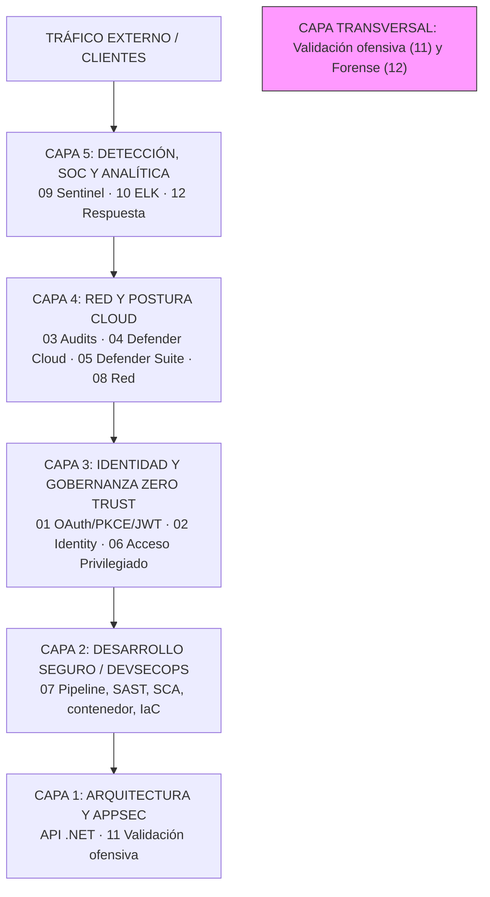

# Lorenzo Lanuza | Portfolio de Ciberseguridad, DevSecOps y Arquitectura

Este portfolio aplica **Security by Design, DevSecOps, Cloud Security y respuesta a incidentes** a una carga de trabajo empresarial: una API .NET protegida con Microsoft Entra ID. El hilo conductor es un modelo de **Defensa en Profundidad** con evidencia y estado de validación en cada capa. Cada módulo responde a la misma pregunta: *¿qué control protege qué y cómo se demuestra?*

> Este repositorio describe laboratorios, código y documentación técnica. No representa despliegues de producción ni certificaciones. Cada práctica indica su estado: **Validado**, **Parcial**, **Runbook preparado**, **Diseño** o **Pendiente**. No se incluyen secretos, identificadores reales ni datos personales.

---

## Arquitectura de referencia

La carga de trabajo es **EcommerceApi** (Web API .NET 10 con OAuth 2.0/PKCE, DTOs, tests y pipeline DevSecOps), versionada en [`lab-api-local-azure`](https://github.com/lanuzalorenzo/lab-api-local-azure).

---

## Módulos y estado

| # | Módulo | Estado |
|---|---|---|
| 01 | [OAuth 2.0, PKCE y JWT](01-seguridad-azure/README.md) | Parcial |
| 02 | [Identity Security](02-identity-security/README.md) | Validado (documental) |
| 03 | [Cloud Audits](03-cloud-audits/README.md) | Validado (documental) |
| 04 | [Defender for Cloud](04-defender-for-cloud/README.md) | Validado (documental) |
| 05 | [Microsoft Defender Suite](05-defender-suite/README.md) | Diseño |
| 06 | [Acceso privilegiado](06-identity-protection/README.md) | Diseño |
| 07 | [DevSecOps y gobernanza](07-devsecops/README.md) | Validado en CI |
| 08 | [Seguridad de red en Azure](08-seguridad-red-azure/README.md) | Diseño + IaC estática |
| 09 | [Microsoft Sentinel](09-microsoft-sentinel/README.md) | Diseño |
| 10 | [ELK Stack Security](10-elk-stack-security/README.md) | Validado en local |
| 11 | [Hacking ético de APIs](11-hacking-etico-api/README.md) | Validado en local |
| 12 | [Forense cloud y respuesta](12-forense-cloud-respuesta/README.md) | Parcial |

**Criterio:** [Estados de validación](#estado-de-validación) — no se presenta un diseño como una validación.

---

## Qué leer primero

- **15 min:** [Guía de lectura](docs/guia-de-lectura.md) → [Índice de evidencias](laboratorio-final/evidencias/README.md) → tabla de estados arriba.
- **60–90 min (hilo identidad + API):** [Arquitectura](laboratorio-final/arquitectura.md) → [Módulo 01](01-seguridad-azure/README.md) → [Módulo 11](11-hacking-etico-api/README.md) + [evidencia BOLA](laboratorio-final/evidencias/2026-10-21-11-api-bola/README.md) → [Módulo 12](12-forense-cloud-respuesta/README.md) + [acta tabletop](laboratorio-final/evidencias/2026-10-22-12-tabletop/README.md).
- **Revisión técnica:** README → índice de evidencias → [módulo 11](11-hacking-etico-api/README.md) → [módulo 07](07-devsecops/README.md) → [API reference](https://github.com/lanuzalorenzo/lab-api-local-azure).

---

## Laboratorio final

[Arquitectura](laboratorio-final/arquitectura.md) · [Plan de ejecución](laboratorio-final/plan-ejecucion.md) · [Índice de evidencias](laboratorio-final/evidencias/README.md).

> Tres evidencias de ejecución (ELK, BOLA/BFLA, tabletop forense) y cuatro documentales (02, 03, 04, 07). Fases Azure pendientes de autorización, presupuesto y resource group temporal; **no hay recursos Azure desplegados**.

---

## Estado de validación

| Estado | Significado |
|---|---|
| **Validado** | Ejecutado y con evidencia enlazada (de ejecución, documental o verificable). |
| **Parcial** | Implementado en código o configuración, pero sin ejecución completa o con brechas. |
| **Runbook preparado** | Pasos y comandos escritos, sin ejecutar. Se muestra como «Diseño · runbook listo». |
| **Diseño** | Arquitectura, procedimiento o IaC documentados; no desplegados. |
| **Pendiente** | Identificado y no iniciado. |

---

## Ecosistema

| Repositorio | Rol |
|---|---|
| **Portfolio** | Documentación, prácticas y narrativa (este repo) |
| **API de referencia** | Código .NET, tests, CI y Bicep → [`lab-api-local-azure`](https://github.com/lanuzalorenzo/lab-api-local-azure) |
| **IA local** | Modelos locales, agentes y seguridad de prompts → [`ai-agent-local-lab`](https://github.com/lanuzalorenzo/ai-agent-local-lab) |
| **Perfil** | Trayectoria y stack → [`lanuzalorenzo`](https://github.com/lanuzalorenzo) |
| **Web** | Portfolio visual y contacto → [`lanuzalorenzo.github.io`](https://lanuzalorenzo.github.io) |

---

## Contacto y licencia

**Autor:** Lorenzo Lanuza Arellano — *Software Architect \| .NET, DevSecOps & Cloud Security*  
**LinkedIn:** [linkedin.com/in/lanuzalorenzo](https://www.linkedin.com/in/lanuzalorenzo) · **GitHub:** [github.com/lanuzalorenzo](https://github.com/lanuzalorenzo) · **Email:** [lanuzalorenzo@gmail.com](mailto:lanuzalorenzo@gmail.com)

Material técnico y formativo. No acredita configuraciones de producción ni certificaciones. Distribuido bajo licencia [MIT](LICENSE).
