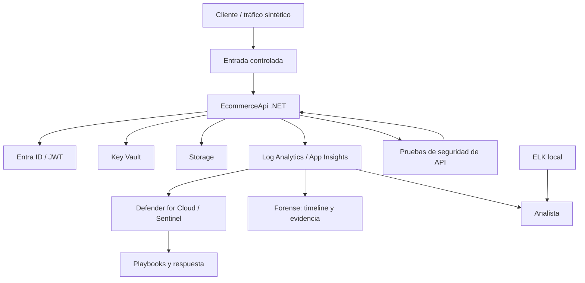

# Arquitectura de referencia

> **Estado:** diseño. La topología no se ha desplegado. El módulo 08 tiene IaC validada estáticamente; el resto de capas son diseño o trabajo parcial.

## Vista de capas

La capa local (ELK) permite practicar ingesta, búsqueda y detección sin depender de Azure. La capa cloud añade identidad, red privada, telemetría y respuesta.

## Capas y límites de confianza

| Capa | Elementos | Límite de confianza | Estado |
|---|---|---|---|
| 1. Workload | API .NET, DTOs, autorización por propietario, tests | Internet/cliente → API | **Validado en CI** para el workload |
| 2. Identidad | Entra ID, OAuth 2.0/PKCE, JWT/JWKS, RBAC, Managed Identities | Cliente/API → proveedor de identidad | Ver módulos 01, 02 y 06 |
| 3. Red | VNet, subredes, NSG, Private Endpoints, DNS privado | Internet → red privada | **Diseño + IaC validada estáticamente** |
| 4. Datos y secretos | Key Vault, Storage, acceso privado | Workload → servicios de datos | **Diseño** |
| 5. Observabilidad | Log Analytics, Application Insights, diagnóstico | Workload → plataforma de logs | **Diseño** |
| 6. Detección y respuesta | Defender for Cloud, Sentinel, KQL, playbooks | Logs → SOC | **Diseño** |
| 7. Validación ofensiva | BOLA/BFLA, mass assignment, pruebas de API | Pruebas controladas → API | **Parcial** (local) |
| 8. Forense | Recolección, integridad, timeline, cadena de custodia | Incidente → evidencia | **Diseño** |
| 9. Laboratorio local | ELK, logs sintéticos, dashboards | Entorno local → analista | **Diseño** |

## Flujos principales

### Flujo de aplicación

1. El cliente obtiene un token de Entra ID.
2. La API valida el token con JWKS y aplica autorización por usuario.
3. La API accede a secretos y datos mediante identidades administradas y Private Endpoints.
4. La telemetría se envía a Log Analytics y Application Insights.
5. Defender y Sentinel correlacionan señales y generan alertas.

### Flujo de validación ofensiva

1. Se ejecutan pruebas controladas contra la API local o un despliegue de laboratorio.
2. Se documenta el hallazgo, la evidencia y la remediación en código o configuración.
3. Se repite la prueba para confirmar la corrección.
4. El resultado se registra con estado **Validado**, **Parcial** o **Pendiente**.

### Flujo forense

1. Se preservan logs y metadatos antes de que expiren o se alteren.
2. Se calcula la integridad de la evidencia cuando procede.
3. Se construye una timeline con KQL o consultas locales.
4. Se documentan decisiones, cadena de custodia y limitaciones.

## Orden de activación

1. **Local:** API, tests, ELK y tabletop forense. Coste cero.
2. **Azure mínimo:** red, Key Vault, Storage y Log Analytics. Resource group temporal.
3. **Azure avanzado:** APIM, AKS/ACR, Sentinel y tokens reales de Entra ID.

No se activa una capa superior si la inferior no tiene evidencia o una limitación declarada.

## Decisiones de diseño

- **Una sola carga de trabajo:** evita laboratorios desconectados y permite reutilizar identidad, red, logs y pruebas.
- **Local primero:** reduce coste y permite practicar el ciclo completo de evidencia antes de Azure.
- **IaC antes que despliegue:** el Bicep se autora y valida estáticamente; el despliegue es un acto separado y autorizado.
- **Evidencia ligada al runbook:** cada salida se puede reproducir y fechar.
- **Sin secretos en el portfolio:** las evidencias se redactan y se enlazan, no se copian sin control.

## Fuera de alcance

- Producción y datos reales.
- Certificaciones o afirmaciones de cumplimiento no auditadas.
- Despliegues Azure sin presupuesto y autorización.
- Publicación de contenido de repositorios privados.
